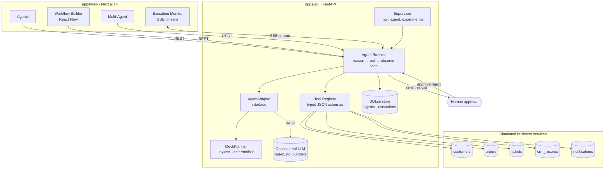

# Orchestrix — Agent Execution Architecture

> Illustrative engineering demonstration. Synthetic data; not a real product.

## System

## The loop

The runtime is vendor-neutral. On each turn it builds a `PlanContext`
(task + instructions + the **tool schemas** the agent may use + the real
step history) and asks the adapter for one `Decision`: call a named tool with
chosen arguments, or finish. It dispatches the tool against live data, feeds
the observation back, and repeats until the adapter finishes or the step
budget is reached.

- **Adapter seam** — the only layer that knows *how* decisions are made.
  `MockPlanner` is the keyless default; a real LLM adapter drops in without
  touching the loop, tools, or UI.
- **Sensitive tools** (`update_crm`, `send_notification`) suspend the run at
  `pending_approval`; nothing executes until a human approves.
- **Failures** retry up to 2×, then land in a `failed` state a human can
  re-drive with Retry.
- **Every state change** is pushed to a per-execution queue and streamed to
  the monitor over SSE.

## Why these boundaries

| Concern | Decision |
|---|---|
| Vendor lock-in | `AgentAdapter` interface; the runtime never imports an SDK. |
| Runs anywhere | Keyless `MockPlanner` default + SQLite — no external deps to demo. |
| Safety | Sensitive tools are declarative (`sensitive=True`) and gated centrally. |
| Observability | One typed `ExecutionStep` per action; streamed live, persisted. |
| State | Executions are a persisted step list → resumable across approval pauses. |
| Scale path | Stateless API; stages (classify/act) can become queue-fed workers. |
