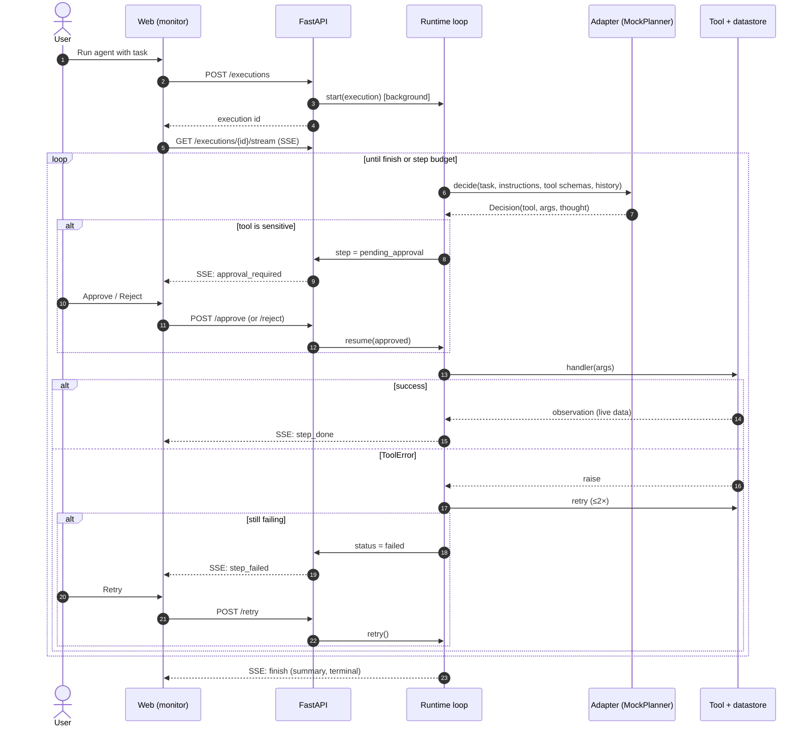

# Tool-Calling Sequence

How one task flows through the runtime, including a sensitive call gated by
human approval and the retry path on failure.



## Decision contract

```python
@dataclass
class Decision:
    action: Literal["tool", "finish"]
    thought: str                    # rationale shown in the UI
    tool:   Optional[str] = None    # must be one of the agent's tools
    args:   dict = {}               # chosen from task + prior observations
    summary: Optional[str] = None   # when action == "finish"
```

The adapter only ever *names* a tool and arguments. The runtime owns
validation, approval, dispatch, retry, persistence, and streaming — so a real
LLM adapter inherits all of it for free.
