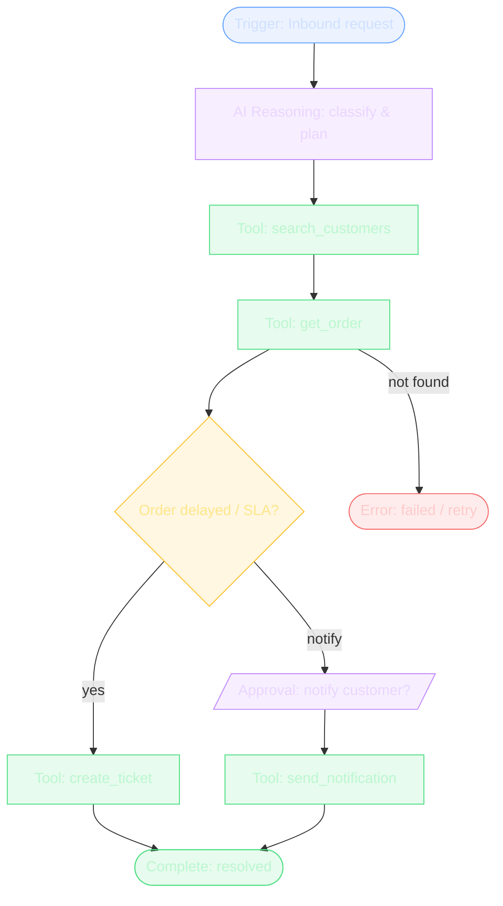

# Workflow Visualization

The **Workflow Builder** (`/workflows`) is a live React Flow editor: add nodes
from the palette, drag to arrange, drag between handles to connect, and press
**Run workflow** to execute the modelled pipeline as a real agent run.

Node types: **trigger**, **AI reasoning**, **tool execution**, **conditional
branch**, **approval**, **completion**, **error**.

The default graph models the Support Resolver pipeline:

The approval node maps to the runtime's real `pending_approval` gate: when the
run reaches `send_notification` (a sensitive tool), execution suspends until a
human approves in the Execution Monitor.
